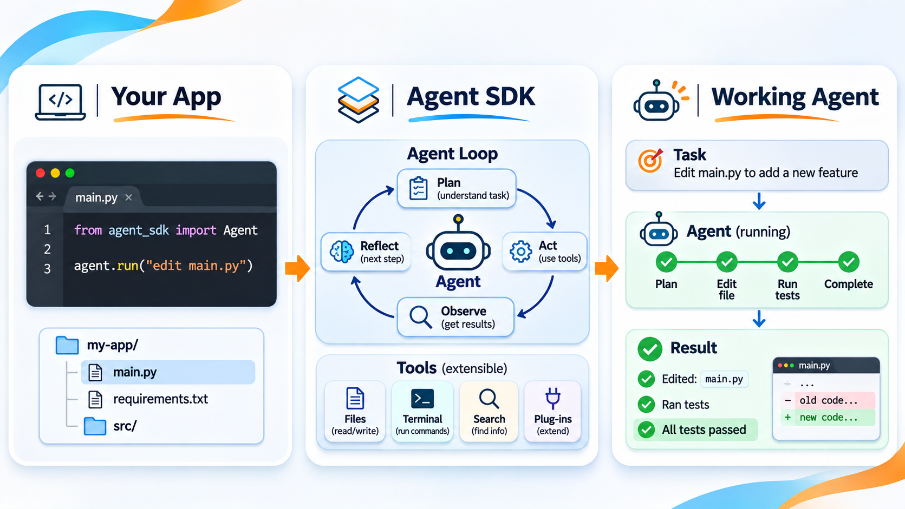



The Claude Agent SDK is Claude Code packaged as a library. Formerly the Claude Code SDK, it ships for Python (claude-agent-sdk) and TypeScript (@anthropic-ai/claude-agent-sdk). Instead of writing your own tool loop, you call query() and the SDK runs the agent loop for you, with built-in tools like Read, Write, Edit, Bash, Glob, Grep and web search. MCP servers, subagents, hooks, sessions and permissions are configured through one options object. You still host and deploy it yourself.
