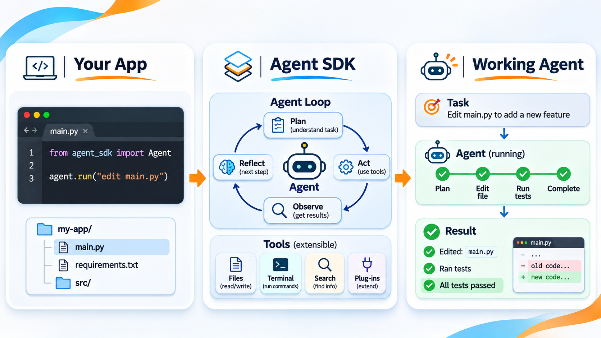

# 🤖 Claude Agent SDK

### 🧰 Claude Code's agent harness, as a library

## 📖 Main Content

The Claude Agent SDK, formerly the Claude Code SDK, gives your app the same agent loop, built-in tools and context management that power Claude Code. In Python and TypeScript, you call query() and stream messages instead of hand-writing the tool loop. Claude can read and edit files, run commands and search the web out of the box, and you can add custom tools. You host it yourself.

## 🔑 Key Concepts

- 🔧 **Built-in tools**: Read, Write, Edit, Bash, Glob, Grep, web search
- 🔌 **MCP**: connect external tools and data
- 🧑‍🤝‍🧑 **Subagents**: delegate focused tasks
- 🪝 **Hooks**: run code at lifecycle points
- 🔐 **Permissions**: control what the agent may do
- 💾 **Sessions**: resume or fork conversations

## 💡 Key Takeaways

- ⚡ Skip writing the agent loop yourself
- 🏠 Harness only: you run the infrastructure
- ⚠️ Not the same as the API Tool Runner

## ✨ One-Line Summary

The Agent SDK lets you embed Claude Code's agent loop in your own app.
