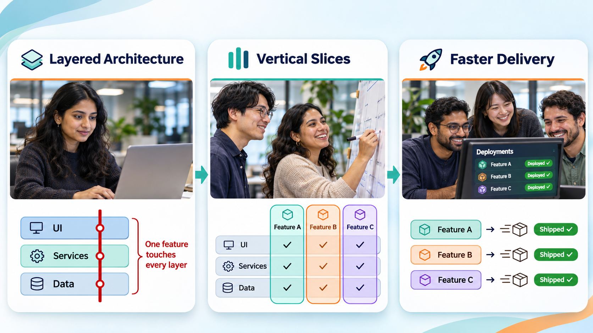

Vertical Slice Architecture organizes code by feature instead of technical layer. Rather than spreading one request across controllers, services and repositories in separate folders, each slice holds everything a single use case needs: request, handler, validation and data access. Popularized by Jimmy Bogard, it keeps related code together, reduces coupling between features, and makes changes safer because a new feature rarely touches existing ones. Teams ship faster and onboard easier.
