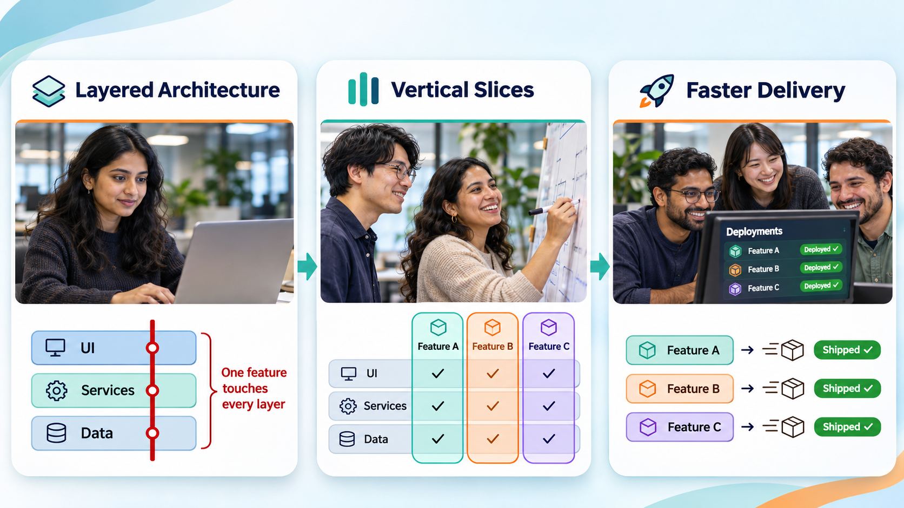

# 🧱 Vertical Slice Architecture

### 🍰 Organize code by feature, not by layer

## 📖 Main Content

### 🏚️ The problem with layers

Most teams start with a layered architecture: controllers, services, repositories and models, each in its own folder or project. It looks tidy, but a single feature such as "Create Order" is scattered across all of them. To change one behavior you open five files in five places, and each layer tends to grow abstractions "just in case". Over time the layers become the unit of organization, even though the business only ever asks for features.

### 🍰 The core idea

Vertical Slice Architecture (VSA) flips the axis. Instead of grouping code by technical role, you group it by request or use case. Each slice owns everything it needs from the edge to the database: the endpoint, the input validation, the business logic and the data access. The guiding rule is often summarized as: minimize coupling between slices, and maximize coupling inside a slice. The approach was popularized by Jimmy Bogard, who paired it with MediatR and CQRS in .NET, but it works in any language and framework.

### 🔬 Anatomy of a slice

Take "Create Order". Its folder holds a request model, a validator, a handler containing the logic, and a response model. Commands that change state and queries that only read are separate slices, so a query can use a lightweight read path while a command uses a richer domain model. Nothing forces every slice to look the same. A simple lookup might be a few lines with a direct database call, while a complex workflow can use domain objects, events and external services.

### ♻️ Sharing code, carefully

The obvious worry is duplication. VSA accepts a little of it on purpose. Shared code is extracted only when the same logic has genuinely appeared several times, often called the rule of three, and only if the pieces really change for the same reason. Premature sharing recreates the coupling you were trying to escape: one edit to a shared helper can break unrelated features. True cross-cutting concerns such as logging, authentication, transactions and validation pipelines still live in shared infrastructure, usually as middleware or behaviors around every request.

### 🧭 When it fits, and when it doesn't

VSA shines in applications with many distinct features and several developers working in parallel, because slices rarely touch the same files, so merge conflicts drop and new teammates can learn one feature at a time. It is also friendly to testing, since each slice can be tested end to end through its public entry point. It is less compelling for tiny CRUD apps, where layers add little cost either way, or for domains with a rich shared model that every feature must respect. Even then, a hybrid works: slice at the edges, and keep a strong domain core underneath.

### 🚀 Getting started

You do not need a rewrite. Pick the next new feature and build it as a slice, in its own folder, with its own handler. Keep the folder structure feature-first, for example Orders/CreateOrder, and let the code inside decide how much structure it needs. As more slices appear, patterns emerge naturally and you can promote repeated code into shared modules. Set a team agreement on naming, on where cross-cutting code lives, and on when sharing is allowed, so freedom does not turn into inconsistency.

### 🕳️ Common pitfalls

Three mistakes show up again and again. First, rebuilding layers inside every slice, with a service and repository for each handler, which brings back the ceremony you wanted to drop. Second, sharing too early, so slices quietly depend on one another through a "common" folder that keeps growing. Third, skipping conventions entirely, which leaves every slice written differently. A short checklist in code review catches all three before they spread.

## 🔑 Key Concepts

- 🍕 **Slice**: one use case, end to end, from endpoint to data
- 🔗 **High cohesion**: everything a feature needs lives together
- ✂️ **Low coupling**: slices stay independent of each other
- 📨 **Request and handler**: each slice is a command or query with its own handler
- 🔀 **CQRS-friendly**: reads and writes can take different paths
- ♻️ **Rule of three**: share code only after real, repeated duplication
- 🧱 **Cross-cutting concerns**: logging, auth and validation stay in shared pipelines
- 🧬 **Hybrid approach**: slices at the edges, a rich domain core underneath

## 💡 Key Takeaways

- 🚀 Faster delivery: a feature change touches one folder, not five layers
- 👥 Easier onboarding: new developers learn one slice at a time
- 🧪 Simpler testing and fewer merge conflicts between teammates
- 🎯 Each slice chooses the right level of complexity for its own job
- 🛠️ Adopt it gradually, starting with the next new feature
- ⚠️ Needs discipline: agree on conventions or duplication and drift creep in
- 🤔 Not a silver bullet: tiny CRUD apps may not need it

## ✨ One-Line Summary

Build around what the system does, not how it's layered: one feature, one slice, everything it needs in one place.
